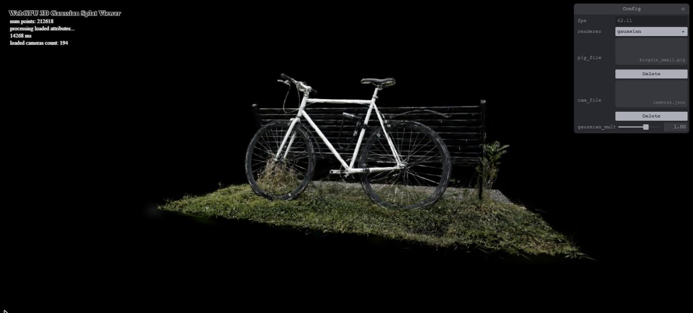
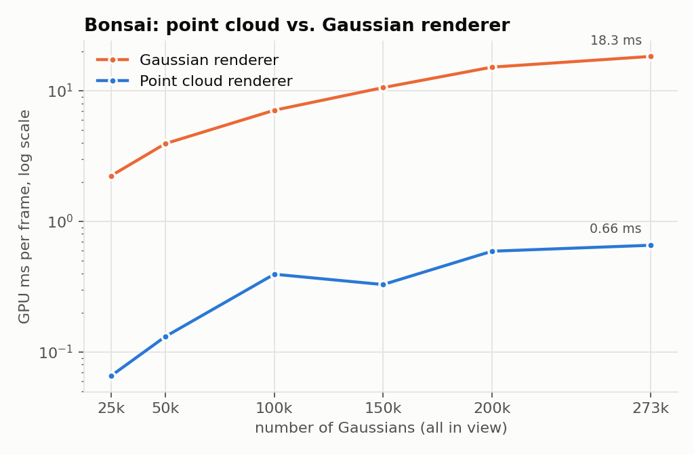
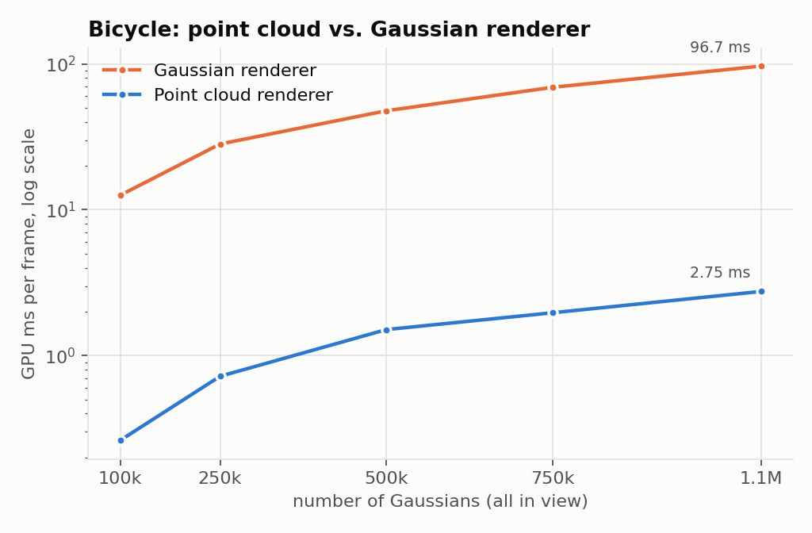
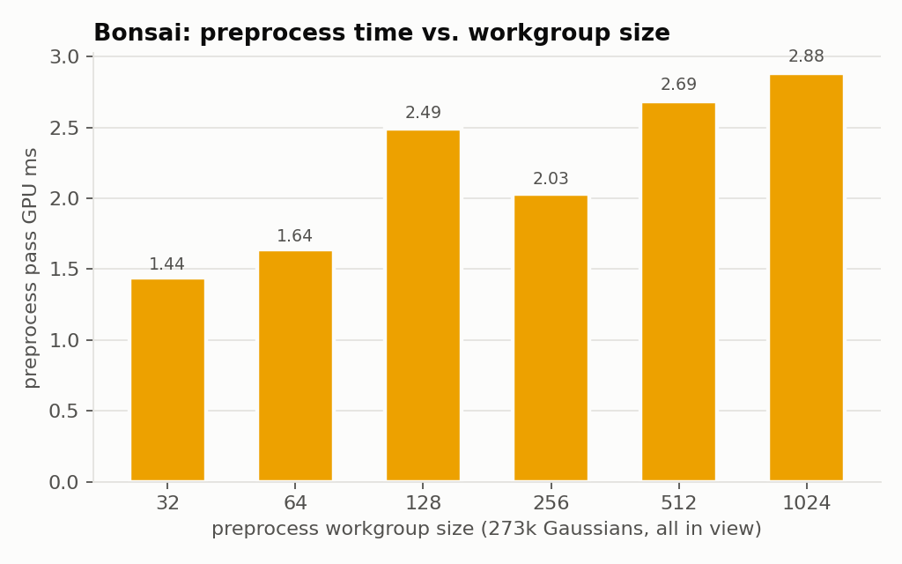
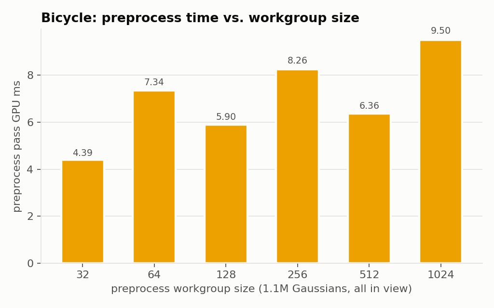
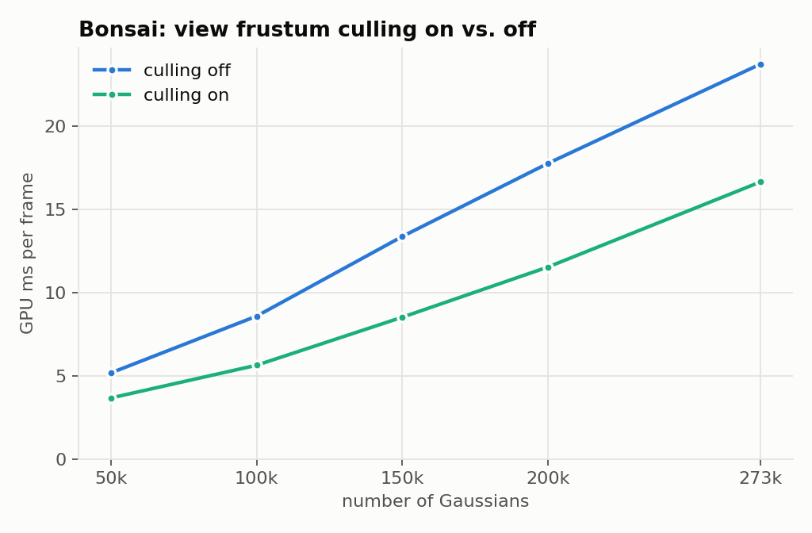
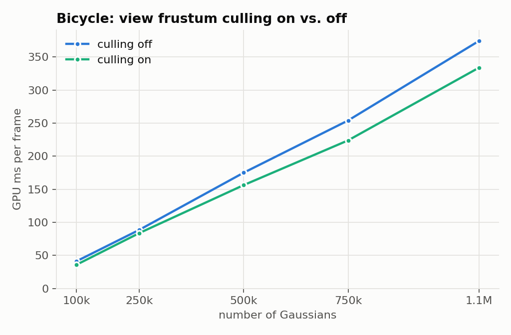
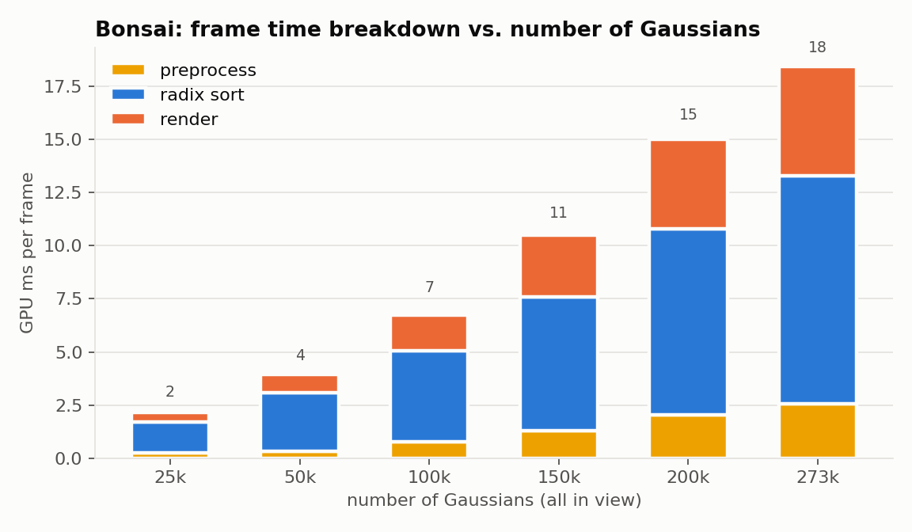
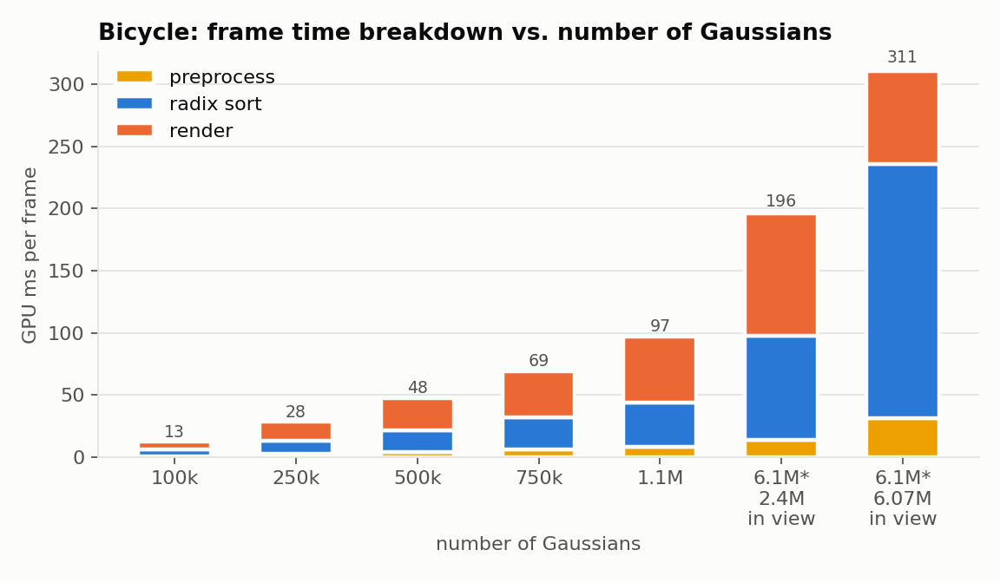

WebGPU Gaussian Splat Viewer
======================

**University of Pennsylvania, CIS 565: GPU Programming and Architecture, Project 5**

* Neel Shejwalkar
  * [LinkedIn](https://www.linkedin.com/in/neel-shejwalkar/), [twitter](https://x.com/neelshej)
* Tested on: **Google Chrome 156.0.8078.48** on
  Windows 11, i7-10510U @ 1.80GHz 16GB, MX250 (GP108) 2GB (Personal Computer)

### Live Demo

### Demo Video/GIF

### README
This is a demo for a point cloud renderer and a 3D Gaussian renderer. Below is performance analysis for both.

#### Timing Methodology
The GPU timestamps were taken from WebGPU timestamp queries. A Gaussian renderer frame is timed from the start of the preprocess compute pass to the end of the render pass, so the four radix sort passes are included, and a point cloud frame is just its one render pass. Unless otherwise noted, the measurements were taken on a 1536x808 canvas with default settings (Gaussian multiplier of 1, preprocess workgroup size of 256), and are a median of around 40 frames. Each configuration was only measured once, so we should expect some run-to-run noise beyond this (I saw up to ~0.5 ms on the preprocess pass alone).

To vary the number of Gaussians, I loaded every k-th Gaussian from the .ply file so the whole scene is always covered. Bicycle was tested with bicycle_30000.cleaned.ply (1,063,091 Gaussians) and bonsai with bonsai.ply (272,956 Gaussians). For every test except culling, the camera was placed so that every Gaussian was in view.

#### Point Cloud vs. Gaussian Renderer
 

Note that the y-axis is log-scaled. Both scenes exhibit very similar scaling behavior over both rendering techniques, with the Bonsai rendering being about 5 times faster than the Bicycle, lining up with the approximately 5 times fewer number of Gaussians - it seems as if the distribution of Gaussians around the two scenes matters far less than simply the amount. This makes sense: unlike the lighting for HW4, for example, the rendering for each Gaussian is completely independent (minus the sort, which also runs in linear time), explaining the predictable linear scaling. Between the two methods, the point cloud renderer is far (around 30x) faster. This is because the point cloud renderer only has a single render pass, with one vertex per Gaussian drawn as a single point. The Gaussian renderer runs preprocessing, radix sorting, then draws quads with alpha blending, resulting in a far more expensive process.

#### Workgroup Size
 

Only the preprocess workgroup size was changed here. The radix sort kept its own block size of 256 threads x 15 keys. For both scenes, small workgroups resulted in better performance in general, and although there were exceptions, these can be attributed to measurement noise (the configuration was only run once). The reason for smaller workgroups winning may have to do with register pressure: each thread is computing a large amount of heavy math, which requires many registers. It's possible that larger workgroups hit the SM limit for register use far more easily than the smaller ones.

#### View Frustum Culling
 

For this test, the camera was placed with only part of the scene in view: bonsai at default view (112,193 of 272,956 Gaussians in view, ~41%), and bicycle at camera moved up slightly (402,453 of 1,063,091 in view, ~38%). Gaussians behind the camera are still removed even with culling off, so this only drops the check against the 1.2x screen bounds. Clearly, culling helps more for higher numbers of Gaussians, which is a result of the structured sampling that's being done for each scene: the ratio of in-frustum points to culled points remains the same, and so higher total points results in a larger benefit. It also seems like the Bicycle scene benefited less than Bonsai, possibly due to it taking up more of the screen. Preprocessing and sorting benefit greatly due to culling, but rendering would not change as much: rasterization clips all of the Gaussians that aren't on screen anyway. 

#### Number of Gaussians
 

All three parts of the pipeline scale linearly, as observed earlier. Preprocess scales roughly linearly with the number of Gaussians in the view frustum, as although a thread is launched per loaded Gaussian, those outside of the frustum skip the expensive math. Sort, similarly, scales with the number of Gaussians in the frustum, as preprocess is the one writing all Gaussian attributes to the sort buffers. Rendering scales with the number of pixels covered. This is why the rendering for the 6M Bicycle is faster than the 2.4M one, because the camera is much farther back and each Splat is much smaller on screen.

### Credits

- [Vite](https://vitejs.dev/)
- [tweakpane](https://tweakpane.github.io/docs//v3/monitor-bindings/)
- [stats.js](https://github.com/mrdoob/stats.js)
- [wgpu-matrix](https://github.com/greggman/wgpu-matrix)
- [@petamoriken/float16](https://github.com/petamoriken/float16)
- [3D Gaussian Splatting for Real-Time Radiance Field Rendering](https://repo-sam.inria.fr/fungraph/3d-gaussian-splatting/)
- [Gaussian splatting notes (kwea123)](https://github.com/kwea123/gaussian_splatting_notes)
- [Spherical harmonics post (beatthezombie)](https://beatthezombie.github.io/sh_post_1/)
- [diff-gaussian-rasterization forward.cu](https://github.com/graphdeco-inria/diff-gaussian-rasterization/blob/main/cuda_rasterizer/forward.cu) and [auxiliary.h](https://github.com/graphdeco-inria/diff-gaussian-rasterization/blob/59f5f77e3ddbac3ed9db93ec2cfe99ed6c5d121d/cuda_rasterizer/auxiliary.h)
- [WGSL function reference (WebGPU Fundamentals)](https://webgpufundamentals.org/webgpu/lessons/webgpu-wgsl-function-reference.html)
- [WebGPU DevTools](https://chromewebstore.google.com/detail/webgpu-devtools/ckabpgjkjmbkfmichbbgcgbelkbbpopi)
- Scene files from the [course drive folder](https://drive.google.com/drive/folders/1Fz0QhyDU12JTsl2e7umGi5iy_V9drrIW?usp=sharing)
- Special Thanks to: Shrek Shao (Google WebGPU team) & [Differential Guassian Renderer](https://github.com/graphdeco-inria/diff-gaussian-rasterization)
